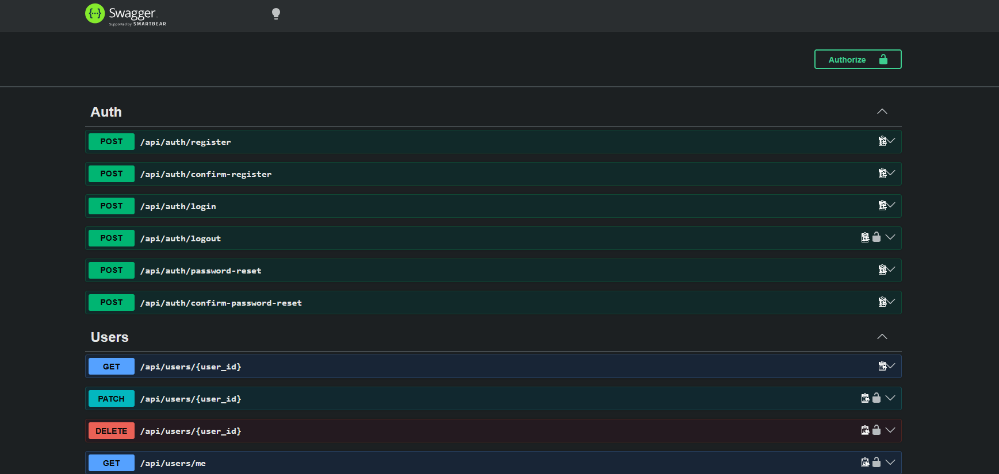
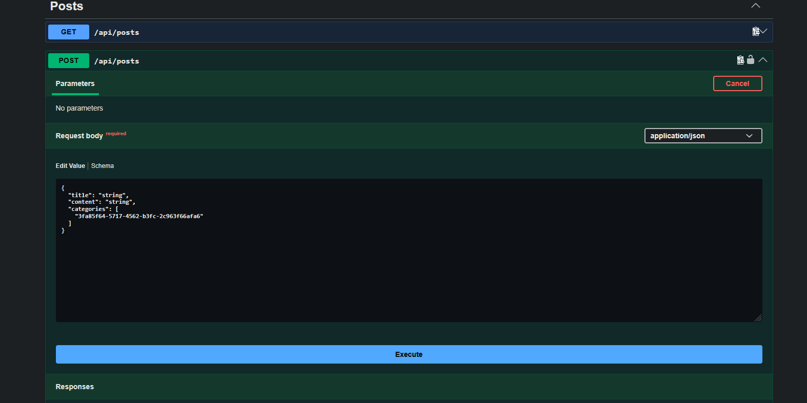
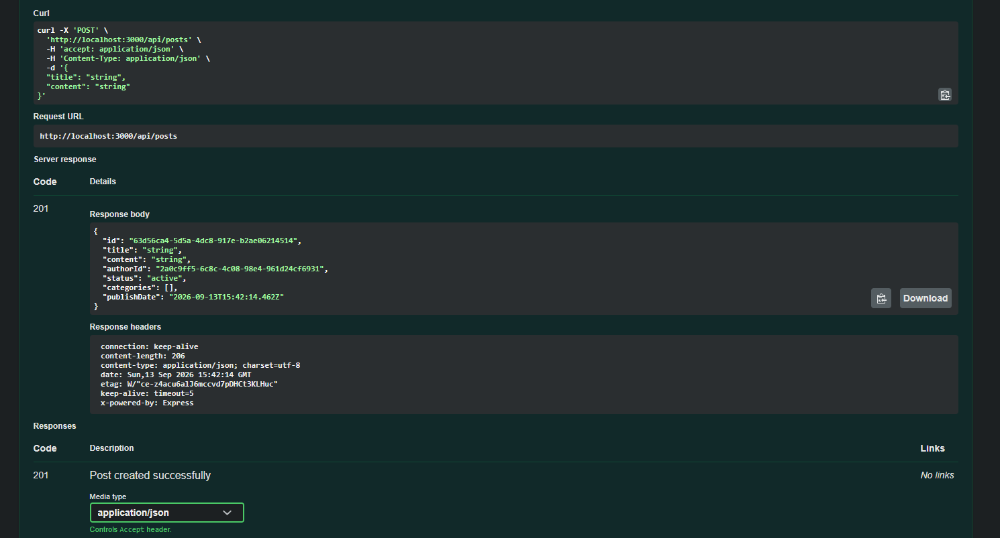

# USOF

USOF backend is a REST API for a Stack Overflow-inspired forum application. It provides endpoints for managing users, 
posts, comments, likes, and other application resources. The API uses Express.js and MySQL for its backend and database.

## Screenshots

Screenshots below demonstrate the project running and being used through the Swagger API documentation.






## Requirements and Dependencies

Before running the project, make sure the following are installed:

- Node.js and npm
- MySQL Server

The project's JavaScript dependencies, including Express.js and other required packages, are installed with npm.

## How to Run

### 1. Clone the repository

```bash
git clone https://github.com/NikolenkoRostislav/usof.git
cd ./usof/backend
```

### 2. Install dependencies

```bash
npm install
```

### 3. Configure MySQL

Make sure the MySQL server is running.

Run the SQL scripts located in `src/infra/db` in the following order:

1. `init.sql`
2. `schema.sql`
3. `seed.sql` (optional)

`seed.sql` can be skipped if test data is not required.

The scripts should be executed in this order because the database must be initialized before the schema and seed data are created.

### 4. Configure the application

Configure the required environment variables, see ```.env.example``` for an example.

### 5. Start the application

```bash
npm start
```

The API will then be available at ```http://<HOST>:<PORT>/api```. By default, the application runs at ```http://localhost:3000/api```

Swagger API documentation is available through the Swagger endpoint at ```http://<HOST>:<PORT>/api-docs```.